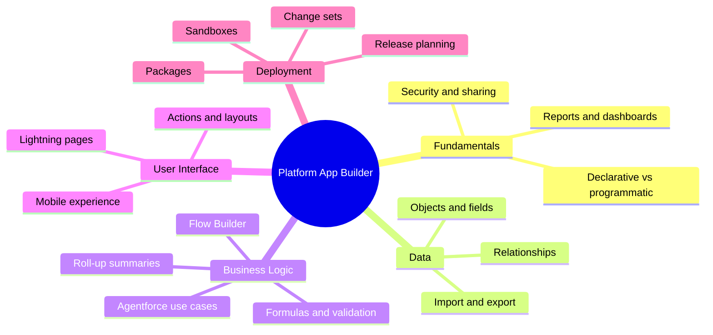
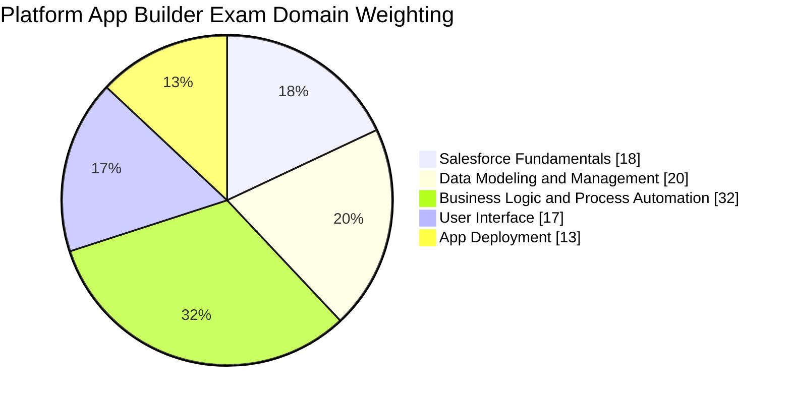
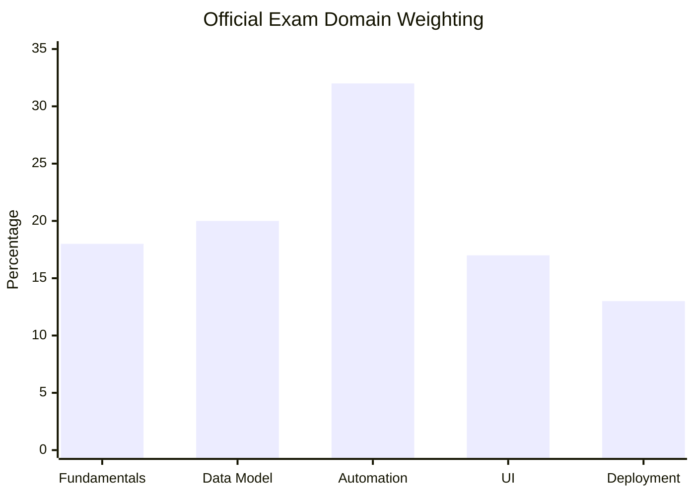
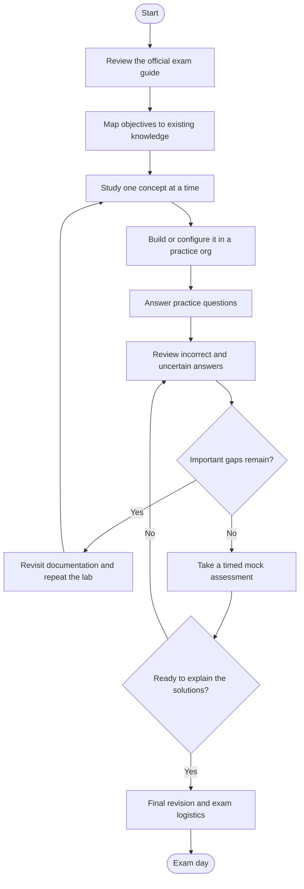
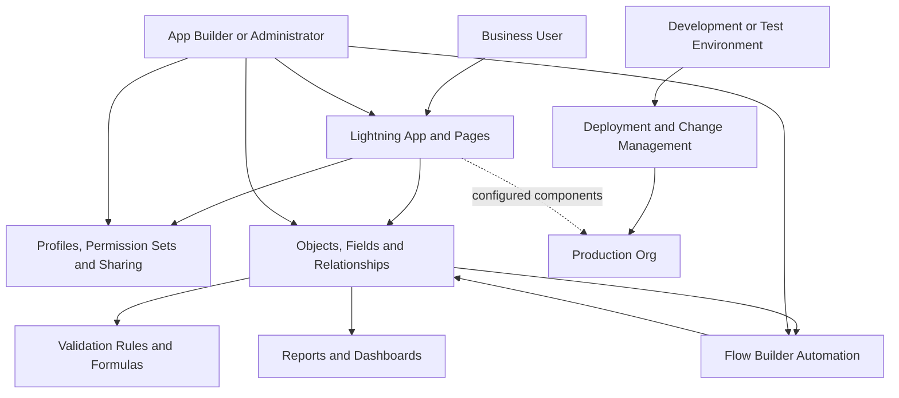
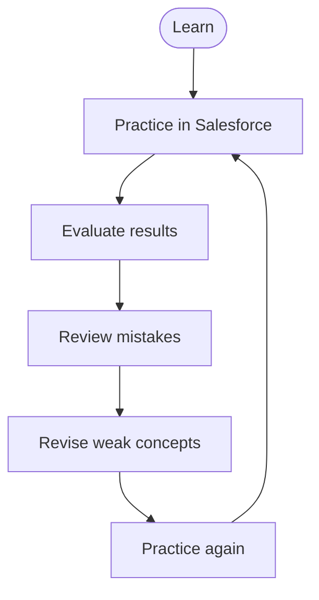
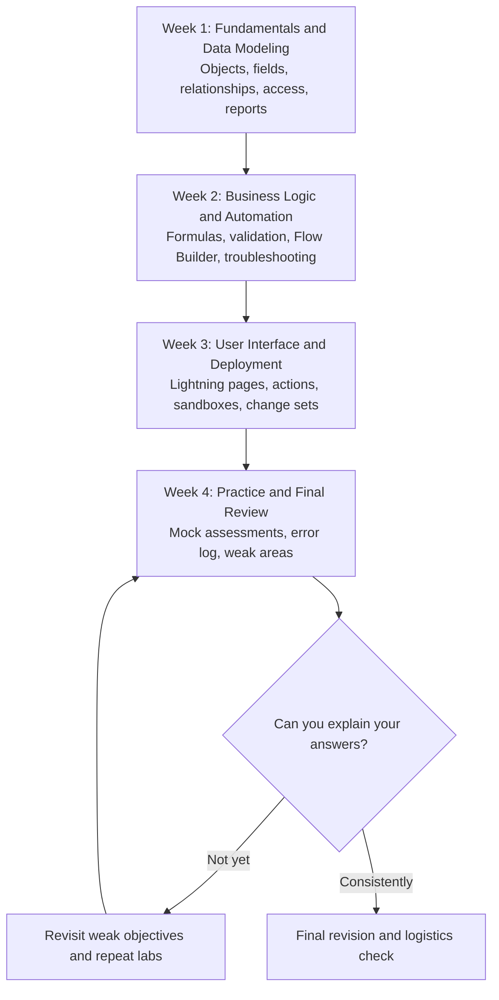

# Salesforce Platform App Builder (DEV-402) Study Guide

A practical, community-oriented study guide for learning Salesforce declarative application development. Explore data modeling, business logic, Flow automation, application security, user interfaces, and deployment through official learning resources, hands-on exercises, revision diagrams, and original practice questions.

> **Important exam-code note:** This repository uses `DEV-402` because it appears in the supplied CertsGate resource listing and historical Salesforce training materials. Salesforce's current credential page identifies the certification as **Salesforce Certified Platform App Builder**. Confirm the current exam name, objectives, and registration details through the official links below before scheduling an exam.

**Supplementary practice resource:** [CertsGate Salesforce preparation resources](https://certsgate.com/exams/salesforce/dev-402)

---

## Table of Contents

- [Overview](#overview)
- [About the Certification](#about-the-certification)
- [Who Should Prepare?](#who-should-prepare)
- [Skills and Knowledge Areas](#skills-and-knowledge-areas)
- [Official Exam Objectives and Weightings](#official-exam-objectives-and-weightings)
- [Preparation Flowchart](#preparation-flowchart)
- [How a Salesforce App Fits Together](#how-a-salesforce-app-fits-together)
- [Circular Study and Revision Cycle](#circular-study-and-revision-cycle)
- [Step-by-Step Study Guide](#step-by-step-study-guide)
- [Four-Week Study Roadmap](#four-week-study-roadmap)
- [Practice Questions](#practice-questions)
- [Hands-On Projects](#hands-on-projects)
- [Common Preparation Mistakes](#common-preparation-mistakes)
- [Career Relevance](#career-relevance)
- [Frequently Asked Questions](#frequently-asked-questions)
- [Official and Additional Learning Resources](#official-and-additional-learning-resources)
- [About CertsGate](#about-certsgate)

---

## Overview

Salesforce Platform App Builder focuses on designing, building, and deploying custom applications with the declarative capabilities of the Salesforce Platform. Declarative development lets builders configure application behavior with tools such as Object Manager, Lightning App Builder, and Flow Builder instead of writing custom code for every requirement.

That does not mean coding knowledge is irrelevant. A capable app builder needs to recognize when a point-and-click solution is appropriate, when a programmatic approach may be necessary, and how the chosen design affects data access, maintainability, automation, and deployment.

This study guide is intended to help candidates organize their learning around the official exam outline. It combines conceptual explanations, practical exercises, review techniques, and original sample questions.

## About the Certification

The **Salesforce Certified Platform App Builder** credential is intended for people who design, configure, and deploy custom applications on the Salesforce Platform.

The official exam guide describes an audience familiar with data models, application security, business logic, automation, user experiences, and application lifecycle management. It recommends practical experience alongside self-study.

### Exam details

Always use the [official Salesforce Platform App Builder exam guide](https://help.salesforce.com/s/articleView?id=005298964&language=en_US&type=1) for the latest requirements.

| Detail | Information |
|---|---|
| Official credential name | Salesforce Certified Platform App Builder |
| Provider | Salesforce |
| Supplied listing code | DEV-402; verify the current exam identifier with Salesforce |
| Main focus | Declarative application design and development |
| Recommended background | Practical experience with Salesforce application building or a comparable platform |
| Official learning path | [Prepare for Your Salesforce Platform App Builder Certification](https://trailhead.salesforce.com/credentials/platformappbuilder) |
| Current exam format and policies | Check the official exam guide before registering |

The currently published Salesforce exam guide lists 60 multiple-choice questions plus up to five unscored questions, 105 minutes, and a 73% passing score. It identifies the exam version as aligned to the SU '26 release. These details can change, so recheck the official guide before your exam date.

## Who Should Prepare?

This certification may be relevant to:

- Salesforce administrators who want to build custom applications.
- Declarative application builders who use point-and-click configuration.
- Business analysts translating business requirements into Salesforce solutions.
- Developers who want to understand the declarative side of the platform.
- Application and systems analysts working with CRM data and workflows.
- Salesforce professionals preparing for broader application design responsibilities.

Candidates benefit from hands-on familiarity with objects, fields, records, page layouts, and the general Salesforce user experience. If these concepts are new, begin with the platform fundamentals before moving into complex automation and deployment scenarios.

## Skills and Knowledge Areas

The exam tests more than whether you can locate a configuration menu. You should be able to select a solution based on a business requirement, understand its limitations, and anticipate its effects on users and data.

| Skill area | What to learn and practice |
|---|---|
| Salesforce fundamentals | Declarative versus programmatic solutions, access controls, sharing, reports, dashboards, and platform capabilities |
| Data modeling and management | Objects, fields, relationships, field types, data import/export, and external data considerations |
| Business logic and automation | Formula fields, roll-up summaries, validation rules, Flow Builder, automation troubleshooting, and Agentforce use cases |
| User interface | Lightning pages, actions, buttons, links, layouts, components, and mobile experiences |
| App deployment | Sandboxes, application lifecycle management, change sets, packages, and deployment planning |

### Concept map

This is an independent learning map, not a replacement for the official exam outline.

## Official Exam Objectives and Weightings

The following percentages come from the Salesforce Platform App Builder exam guide currently available at the time this README was prepared.

| Official domain | Weight |
|---|---:|
| Salesforce Fundamentals | 18% |
| Data Modeling and Management | 20% |
| Business Logic and Process Automation | 32% |
| User Interface | 17% |
| App Deployment | 13% |

### Domain weightage: pie chart

### Domain weightage: bar chart

Business Logic and Process Automation carries the largest share of the published blueprint. Give Flow Builder, formulas, validation rules, automation selection, and troubleshooting substantial practice time. Do not ignore smaller domains: fundamentals, user interface, and deployment can still make a meaningful difference to your overall preparation.

**Source:** [Salesforce Certified Platform App Builder Exam Guide](https://help.salesforce.com/s/articleView?id=005298964&language=en_US&type=1)

Salesforce may update the exam blueprint as the platform evolves. Revisit the guide before studying and again before registering.

## Preparation Flowchart

Use this process to turn the official objectives into a repeatable study plan. If your practice results reveal a knowledge gap, return to the relevant documentation or hands-on exercise before moving forward.

## How a Salesforce App Fits Together

A custom Salesforce application brings data, user access, interface design, and automation together. Understanding their relationships helps you answer scenario-based questions and avoid solutions that work in isolation but fail in a real business process.

The diagram below is a **conceptual example**, not a prescribed Salesforce architecture.

### Design questions to ask

Before implementing a requirement, consider:

1. **Data:** What records and relationships represent the business process?
2. **Access:** Which users should view, create, edit, or share each record?
3. **Logic:** Is a formula, validation rule, or Flow the most suitable declarative tool?
4. **Experience:** What page, layout, action, or component helps users complete the task?
5. **Lifecycle:** How will you test, move, and maintain the change safely?

## Circular Study and Revision Cycle

Certification preparation is iterative. Reading a topic once is not enough; you need to apply it, evaluate your understanding, review mistakes, and return to the relevant material.

Keep a short error log. For each mistake, record the objective, the reason your answer was wrong, the correct reasoning, and the next action you will take. Revisit that item after a delay to see whether you genuinely understand it.

## Step-by-Step Study Guide

### 1. Start with the official exam objectives

Read the exam guide from beginning to end. Turn each objective into a checklist and label it as unfamiliar, developing, or comfortable.

Pay attention to the verbs. An objective asking you to *create*, *configure*, or *troubleshoot* usually calls for more practical work than one asking you only to *describe* a feature.

### 2. Build a strong data model

Practice creating custom objects, choosing appropriate field types, and connecting records with relationships. Learn how relationship choices affect record access, page behavior, and reporting.

Use a small business scenario—for example, tracking customers, service requests, and related activities—to explore how the data model supports the business process.

### 3. Learn security as part of application design

Study object permissions, field-level security, record access, and sharing solutions. Understand that access is layered: giving a user permission to an object does not automatically mean that every record should be visible to them.

For each practice scenario, ask what the user needs to do and which access mechanism satisfies that requirement without granting unnecessary permissions.

### 4. Spend deliberate time in Flow Builder

Because Business Logic and Process Automation is the largest domain in the current outline, practice creating and configuring flows rather than relying only on videos or written explanations.

Build simple automations first. Then investigate entry conditions, decisions, updates, fault handling, testing, monitoring, and troubleshooting. Learn to identify when a declarative solution is suitable and when another approach may be more appropriate.

Also review the official exam guide's coverage of Agentforce as a way to support business processes. Focus on the stated use cases and limitations rather than assuming every automation should use AI.

### 5. Configure useful user experiences

Create Lightning pages, update page layouts, configure actions, and explore mobile-friendly designs. Compare the options available for different user tasks.

A useful test is whether a change makes the correct information and actions available to the right users without introducing unnecessary complexity.

### 6. Practice deployment and change management

Learn the purpose of development and test environments, the role of sandboxes, and the considerations involved in moving changes between environments. Review change sets and package options in the context of the requirements described by the exam guide.

Practice planning a release, checking dependencies, testing the result, and identifying how you would investigate a deployment problem.

### 7. Assess your readiness

Use original practice questions and mock assessments to find weak areas. After each attempt, return to the relevant official objective and confirm that you can explain the reasoning.

You should be able to justify why a solution fits the scenario, why a plausible alternative does not, and what limitation or side effect matters.

## Four-Week Study Roadmap

This is a suggested schedule, not an official Salesforce timeline. Adjust it to your prior experience and available study time.

| Week | Main goal | Suggested output |
|---|---|---|
| 1 | Understand fundamentals and data design | A small data model with appropriate fields and relationships |
| 2 | Apply business logic and automation | A tested flow plus formulas and validation rules |
| 3 | Improve the user experience and understand deployment | A configured app page and a written deployment plan |
| 4 | Evaluate readiness and close gaps | A reviewed error log and completed mock assessments |

If you already have substantial Salesforce experience, spend less time on familiar concepts and more time on areas where your practice results show uncertainty.

## Practice Questions

These are **original study questions created for this repository**. They are not official Salesforce exam questions and are not taken from a live exam.

### Question 1: Data relationships

A business needs to track several service requests for each customer and report on those requests by customer. What should you evaluate first?

A. Whether every service request should be stored in a text field  
B. The appropriate relationship between the customer and service-request records  
C. Whether a dashboard can replace the underlying data model  
D. Whether all users should receive administrator permissions  

**Answer: B.** A suitable relationship provides a structured connection between records and supports meaningful reporting. The exact relationship type depends on the business requirements and the desired behavior.

### Question 2: Data quality

Users must not save an opportunity unless a required business condition is satisfied. Which declarative feature should you consider?

A. Validation rule  
B. Dashboard filter  
C. Page theme  
D. Package installation  

**Answer: A.** A validation rule checks a condition and prevents saving when the rule's criteria are met. Design and test the condition carefully so that valid business scenarios are not blocked.

### Question 3: Automation

A business process needs to evaluate conditions and update Salesforce records when the relevant criteria are met. Which tool should you investigate first for a declarative solution?

A. Flow Builder  
B. A report subscription alone  
C. A page layout alone  
D. A dashboard component  

**Answer: A.** Flow Builder supports declarative process automation. The appropriate flow type and configuration depend on when the process should run and what it must accomplish.

### Question 4: Access control

A user needs access to particular fields on an object but should not receive broad access to unrelated fields. Which control is directly relevant?

A. Field-level security  
B. Dashboard color settings  
C. Record naming conventions  
D. Sandbox refresh scheduling  

**Answer: A.** Field-level security helps determine which fields users can view or edit. It must be considered alongside object permissions and record-level access.

### Question 5: Deployment planning

A team needs to validate application changes before making them available in production. What is the most appropriate general approach?

A. Make every change directly in production without testing  
B. Use an appropriate development or test environment and follow a controlled deployment process  
C. Replace all custom objects with text fields  
D. Skip dependency checks if the application opens successfully  

**Answer: B.** Testing and controlled deployment help uncover configuration problems before release. The exact environment and deployment method depend on the team's requirements.

### How to use practice questions effectively

For every answer:

1. Explain why the selected option satisfies the requirement.
2. Explain why the other options do not.
3. Identify the relevant official exam objective.
4. Build or configure the feature in a practice environment where possible.
5. Revisit incorrect or uncertain answers later.

Third-party practice questions can help identify gaps, but they should complement official documentation and practical exercises—not replace them.

## Hands-On Projects

Practical projects help connect separate features into a working application.

### Project 1: Customer and service-request tracker

**Goal:** Create a small app for managing customers and their service requests.

Tasks:
- Design the objects, fields, and relationships.
- Create appropriate page layouts and Lightning pages.
- Configure access for different user roles.
- Create a report showing service requests by status.
- Test the application with representative records.

**Skills practiced:** Data modeling, application security, user interface design, and reporting.

### Project 2: Request validation and automation

**Goal:** Improve the quality and consistency of submitted requests.

Tasks:
- Define the conditions that make a request valid.
- Configure validation rules for required business conditions.
- Build a flow that updates records when appropriate.
- Test expected and unexpected inputs.
- Review flow errors and improve the design.

**Skills practiced:** Validation rules, Flow Builder, testing, troubleshooting, and automation design.

### Project 3: Controlled app release

**Goal:** Prepare a set of application changes for deployment.

Tasks:
- Identify the configuration changes needed for a release.
- Select an appropriate development or test environment.
- Review dependencies and deployment options.
- Test the target configuration.
- Document the release steps and a rollback or recovery approach appropriate to the environment.

**Skills practiced:** Application lifecycle management, deployment planning, testing, and change management.

These projects are illustrative exercises, not official Salesforce superbadges or required exam assignments.

## Common Preparation Mistakes

- **Studying only definitions:** Knowing what a feature is does not prove you can choose or configure it for a scenario.
- **Ignoring Flow Builder:** Give automation practice meaningful time because it is a major part of the current exam outline.
- **Treating security as one setting:** Understand how object permissions, field-level security, and record access work together.
- **Memorizing questions:** Repeated exposure is less useful if you cannot explain the underlying principle.
- **Skipping deployment:** Review environments, dependencies, change sets, packages, and release planning.
- **Using outdated exam outlines:** Always check the current official guide instead of relying on an old course handout or third-party summary.
- **Ignoring incorrect answers:** Mistakes are most valuable when you identify the reason behind them and revisit the relevant concept.

## Career Relevance

The Platform App Builder skill set is relevant to work involving Salesforce configuration, business-process improvement, custom application design, and declarative automation.

Depending on experience and other responsibilities, these skills may support roles such as Salesforce administrator, platform app builder, business analyst, or application analyst. A certification is one way to demonstrate knowledge; practical project work, communication, troubleshooting, and ongoing learning also matter.

Use this credential to build and demonstrate skills rather than treating the exam as a substitute for hands-on experience.

## Frequently Asked Questions

### What is the Salesforce Platform App Builder certification?

It is a Salesforce credential for demonstrating skills in designing, building, and deploying custom applications using the platform's declarative capabilities.

### Is DEV-402 the current exam code?

DEV-402 appears in the supplied CertsGate listing and in older Salesforce training materials as the code for *Declarative Development for Platform App Builders*. The current Salesforce credential page identifies the certification by its name, **Salesforce Certified Platform App Builder**. Verify the current exam identifier and registration details through Salesforce before booking.

### What are the main exam domains?

The currently published guide lists Salesforce Fundamentals, Data Modeling and Management, Business Logic and Process Automation, User Interface, and App Deployment. Consult the official guide for the latest domain definitions and percentages.

### How should I prepare for Flow Builder questions?

Build and test flows in a practice environment. Learn how to select the appropriate flow type, configure logic, handle errors, and troubleshoot unexpected behavior. Connect each exercise to the relevant objective in the official guide.

### Are practice questions enough to prepare?

No single resource should be treated as sufficient by itself. Combine the official exam outline, Salesforce documentation, Trailhead learning, hands-on exercises, and practice questions with careful review of mistakes.

### Where can I find official learning resources?

Start with the [Salesforce Platform App Builder credential page](https://trailhead.salesforce.com/credentials/platformappbuilder) and its recommended learning path. Use the official exam guide to identify additional documentation and practical topics.

### How do I know when I am ready?

Readiness is stronger when you can explain why a solution is correct, compare it with alternatives, complete relevant tasks in a practice org, and consistently address the weaknesses found in practice assessments. A mock-test score alone cannot guarantee an exam result.

## Official and Additional Learning Resources

Use official Salesforce sources as the foundation of your preparation.

- **[Salesforce Certified Platform App Builder Exam Guide](https://help.salesforce.com/s/articleView?id=005298964&language=en_US&type=1)** — exam objectives, domain weighting, published exam details, and recommended preparation materials.
- **[Salesforce Platform App Builder Credential Page](https://trailhead.salesforce.com/credentials/platformappbuilder)** — official credential information and study resources.
- **[Prepare for Your Salesforce Platform App Builder Certification](https://trailhead.salesforce.com/credentials/platformappbuilder)** — entry point for the official Trailhead learning path.
- **[Salesforce Help](https://help.salesforce.com/)** — product documentation and configuration guidance.
- **[Salesforce Developer Documentation](https://developer.salesforce.com/docs)** — technical documentation for Salesforce platform capabilities.
- **[Salesforce Certification Overview](https://help.salesforce.com/s/articleView?id=005298929&language=en_US&type=1)** — information about the broader certification program.
- **[CertsGate Salesforce Preparation Resource](https://certsgate.com/exams/salesforce/dev-402)** — an independent supplementary resource for reviewing study material and practice questions.

Use third-party materials to reinforce learning, not as evidence that a question will appear on the exam. When sources disagree, prioritize the current official Salesforce documentation.

## About CertsGate

[CertsGate](https://certsgate.com/) provides independent IT certification preparation resources. Candidates can explore its Salesforce listing for supplementary study material and practice questions while working through the official objectives.

A balanced preparation approach is to learn the concept from official documentation, apply it in a Salesforce practice environment, and then use practice questions to identify any remaining gaps. CertsGate is an additional study resource, not a replacement for Salesforce documentation or hands-on experience.
